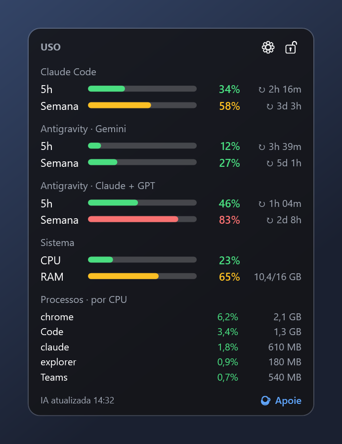
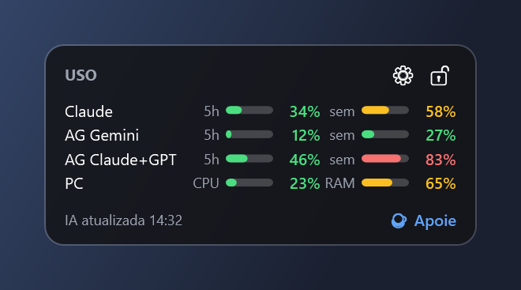
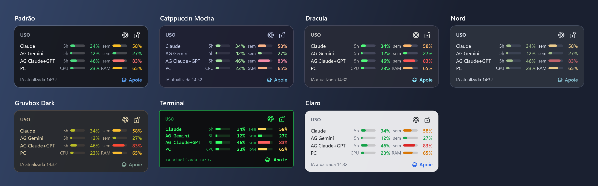

# Widget de Uso

Widget flutuante para Windows 11 que fica sempre por cima das outras janelas e mostra:

- **Claude Code**: uso da sessão (5h) e da semana, com tempo até o reset.
- **Google Antigravity**: uso de 5h e semanal de cada grupo de modelos (Gemini e Claude + GPT).
- **Sistema**: uso de CPU e memória RAM, e os processos que mais consomem recursos.

As cores das barras mostram a situação: **verde** abaixo de 50%, **amarelo** de 50% a 80% e **vermelho** acima de 80%.

<table>
  <tr>
    <th>Visão detalhada</th>
    <th>Visão resumida</th>
  </tr>
  <tr>
    <td valign="top"></td>
    <td valign="top"></td>
  </tr>
</table>

<sub>Imagens com dados de demonstração.</sub>

---

## Requisitos

- Windows 10 ou 11 (64 bits).
- **SDK do .NET 8**, necessário apenas para compilar.
- Opcional, para os dados de IA:
  - [Claude Code](https://claude.com/claude-code) instalado e logado (comando `claude`).
  - Google Antigravity CLI instalado e logado (comando `agy`).

Sem o Claude Code ou o Antigravity, o widget continua funcionando: basta desligar essas seções no menu ⚙ e usar só o monitor do sistema.

---

## Instalação

### 1. Instale o SDK do .NET 8

Escolha uma das opções:

- **winget** (se disponível):
  ```powershell
  winget install Microsoft.DotNet.SDK.8
  ```
- **Instalador oficial**: baixe em <https://dotnet.microsoft.com/download/dotnet/8.0> (seção *SDK*, Windows x64).

Confira a instalação abrindo um novo terminal:

```powershell
dotnet --list-sdks
```

### 2. Baixe e compile o widget

Baixe o código com Git (ou pelo botão **Code → Download ZIP** no GitHub):

```powershell
git clone https://github.com/MarleySMaia/widget-claude-status.git
cd widget-claude-status
```

Na pasta do projeto (onde estão `Program.cs` e `UsageWidget.csproj`):

```powershell
dotnet publish -c Release -o publish
```

O executável fica em `publish\UsageWidget.exe`. Ele é *self-contained*: já inclui o runtime do .NET, então pode ser copiado para qualquer pasta, ou outro PC Windows x64, e funciona sem instalar nada.

### 3. Execute

Dê dois cliques em `publish\UsageWidget.exe`. O widget aparece no canto superior direito da tela, e um ícone com três barrinhas coloridas aparece na bandeja do sistema, perto do relógio.

> Na primeira execução o Windows pode mostrar um aviso do SmartScreen, porque o executável não é assinado. Clique em **Mais informações → Executar assim mesmo**.

### 4. (Opcional) Iniciar junto com o Windows

1. Pressione `Win + R`, digite `shell:startup` e pressione Enter.
2. Na pasta que abrir, crie um **atalho** para o `UsageWidget.exe`. Clique com o botão direito no `.exe`, escolha **Mostrar mais opções → Criar atalho** e mova o atalho para essa pasta.

---

## Como usar

| Ação | Como fazer |
|---|---|
| Mover o widget | Arraste com o botão esquerdo do mouse. A posição é lembrada. |
| Travar (modo fantasma) | Clique no cadeado 🔓 ou use `Ctrl + Alt + U`. Os cliques passam a atravessar o widget para as janelas de trás. |
| Destravar | Passe o mouse sobre o cadeado 🔒 e clique, ou use `Ctrl + Alt + U`. |
| Abrir configurações | Clique no ⚙. Funciona também no modo fantasma. |
| Mostrar / ocultar | Clique com o botão esquerdo no ícone da bandeja. |
| Atualizar agora / Sair | Clique com o botão direito no ícone da bandeja. |
| Sobre / apoiar o projeto | Botão **☕ Apoie** no canto inferior direito do widget, menu ⚙ ou bandeja → **Sobre / Apoie o projeto ☕**. |

---

## Configuração

Clique no **⚙** para abrir o menu:

- **Visão**
  - **Resumida**: uma linha por fonte, com mini barras. O widget fica bem menor.
  - **Detalhada**: barras completas, tempo até o reset, memória em GB e lista de processos.
- **Mostrar**: liga ou desliga cada seção.
  - Claude Code
  - Antigravity
  - CPU e memória
  - Processos que mais consomem (aparece só na visão detalhada)
- **Ordenar processos por**: CPU ou Memória.
- **Tema**: escolha a aparência do widget (veja [Temas](#temas)).

As escolhas são salvas automaticamente e mantidas ao reabrir o widget.

### Temas



Temas incluídos:

| Tema | Estilo |
|---|---|
| **Padrão** | Escuro neutro, verde/amarelo/vermelho. |
| **Catppuccin Mocha** | Escuro em tons pastel. |
| **Dracula** | Escuro com roxo, ciano e rosa. |
| **Nord** | Azul-acinzentado "ártico". |
| **Gruvbox Dark** | Escuro quente, estilo retrô. |
| **Terminal** | Preto com verde fósforo, fonte Consolas e barras retas. |
| **Claro** | Fundo claro, para quem usa o Windows no modo claro. |

Para incluir um tema novo, adicione-o à lista `BuiltIn()` da classe `Themes` em `Program.cs`: ele aparece automaticamente no menu ⚙ → **Tema**. Basta informar as cores que mudam; o resto vem do tema Padrão. Contribuições de temas são bem-vindas via pull request.

### Arquivos de configuração

Ficam em `%APPDATA%\UsageWidget\`:

| Arquivo | Conteúdo |
|---|---|
| `settings.json` | Preferências do menu ⚙. Pode ser editado à mão com o widget fechado. |
| `pos.txt` | Posição do widget na tela. |

Exemplo de `settings.json`:

```json
{
  "Compact": false,
  "Claude": true,
  "Antigravity": true,
  "Sys": true,
  "Processes": true,
  "SortByMemory": false,
  "TopN": 5,
  "Theme": "Padrão"
}
```

`TopN` define quantos processos aparecem na lista e só pode ser alterado por este arquivo.

Para voltar às configurações padrão, feche o widget e apague a pasta `%APPDATA%\UsageWidget`.

---

## Frequência de atualização

| Dado | Intervalo |
|---|---|
| Claude Code e Antigravity | a cada 5 minutos |
| CPU, memória e processos | a cada 3 segundos |
| Contagem regressiva do reset | a cada 30 segundos |

Os dados de IA vêm dos comandos `claude -p "/usage"` e `agy -p "/usage"`, executados em segundo plano. Desligar uma seção no menu também interrompe essa consulta.

---

## Solução de problemas

**O widget mostra "Claude falhou" ou "Antigravity falhou".**
Abra um terminal e rode o comando correspondente:

```powershell
claude -p "/usage"
agy -p "/usage"
```

Se der erro, faça login novamente na ferramenta (`claude auth login` no Claude Code). O widget procura os programas em `%USERPROFILE%\.local\bin\claude.exe` e `%LOCALAPPDATA%\agy\bin\agy.exe`. Se não estiverem lá, usa os que estiverem no PATH.

**O widget sumiu da tela.**
Clique no ícone da bandeja para mostrá-lo. Se ele estiver fora da área visível, por exemplo depois de desconectar um monitor, feche o widget, apague `%APPDATA%\UsageWidget\pos.txt` e abra de novo.

**O atalho `Ctrl + Alt + U` não funciona.**
Outro programa pode estar usando a mesma combinação. Use o cadeado ou o menu da bandeja.

**Abri o widget duas vezes e nada aconteceu.**
É proposital: só uma instância roda por vez. Procure o ícone na bandeja.

---

## Privacidade e segurança

- O código não contém senhas, tokens nem chaves. Os dados de uso vêm das ferramentas já logadas no seu computador, então cada pessoa vê apenas o próprio uso.
- O widget não envia dados para a internet, não abre portas de rede e não precisa de permissão de administrador.
- A lista de processos mostra o que está aberto no computador. Tenha isso em mente ao compartilhar a tela.

---

## Apoie o projeto ☕

Se o widget for útil para você, considere pagar um café ao autor. Qualquer valor via **Pix** ajuda. A chave e o QR Code ficam na janela **Sobre / Apoie o projeto**, aberta pelo botão **☕ Apoie** no rodapé do widget, pelo menu ⚙ ou pela bandeja.

Desenvolvido por [@MarleySMaia](https://github.com/MarleySMaia).

---

## Compartilhando o projeto

Para enviar o código a outra pessoa, compartilhe apenas:

- `Program.cs`
- `UsageWidget.csproj`
- `README.md`
- `LICENSE`

As pastas `bin`, `obj` e `publish` são geradas na compilação e podem ser apagadas. O `.gitignore` já as exclui do Git.

---

## Licença

Distribuído sob a licença [MIT](LICENSE).
